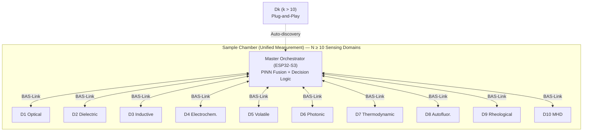

# Biogeophysical Admittance Spectroscopy (BAS): A Unified Multimodal Framework for Reagent-Free Solid-State Diagnostic Support with Distributed Central Orchestrator (BCO)

**Daniel Vivas¹,\***, **Jose Sanchez²**, **Yndira Brito¹**  
¹ Universidad de Carabobo, Venezuela  
² UPTLL Juana Ramírez, Venezuela  
\* Correspondence: dvivas1@uc.edu.ve  
**March 2026**

## Abstract

The lack of access to clinical diagnostics in resource-limited regions represents a global health crisis. This paper presents the unified BAS (Biogeophysical Admittance Spectroscopy) framework with integrated BCO (BAS Central Orchestrator), a technology designed specifically to aid in diagnostics through rapid triage in vulnerable populations. The system integrates an extensible N-domain architecture (N ≥ 10) distributed across a multi-node ESP32-S3 cluster. We detail the biological and physical-mathematical foundations of each domain (Optical, Dielectric, Inductive, Electrochemical, Volatile, Photonic, Thermodynamic, Autofluorescence, Rheological, Magnetohydrodynamic), along with the distributed hardware architecture, BAS-Link communication protocol, physics-informed inference algorithms (PINN), and uncertainty budgets. The fundamental objective is to provide diagnostic technological sovereignty, demonstrating the viability of a low-cost portable distributed system capable of reducing health inequity through accessible point-of-care diagnostic support with hardware resilience and scalability. Note: This system is a triage support tool and not a definitive diagnostic device.

**Keywords:** BAS Framework, BCO Orchestrator, Edge AI, Humanitarian Triage, Multimodal Spectroscopy, ESP32-S3, Distributed Computing, Physics-Informed Neural Networks, Diagnostic Support, BAS-Link Protocol, Extensible Architecture.

## 1. Introduction

Early detection of cellular anomalies —including metabolic disorders, genomic anomalies, and infections— remains a critical challenge in global health, particularly in resource-limited settings where conventional diagnostic infrastructure is unavailable or prohibitively expensive [1,2]. Standard methods such as flow cytometry, karyotyping, and PCR require bulky equipment, perishable reagents, and specialized personnel, creating significant barriers to widespread implementation [3].

The fundamental objective of the BAS framework transcends technical innovation: it seeks to serve humanity by acting as a rapid triage option in localities and populations with limited access to health services [1]. By eliminating dependence on chemical reagents and centralized laboratories, this system aims to democratize access to basic cellular diagnosis. It is crucial to emphasize that BAS is designed to **aid in diagnostics (triage/screening), not to definitively replace gold-standard methods**, but to prioritize patients requiring urgent attention.

### Important Clinical Disclaimer

> The BAS-Cluster is explicitly designed as a **screening and triage support system, not a definitive diagnostic device**. Results indicate probability, not certainty, and clinical decisions should integrate BAS output with patient history and confirmatory testing by qualified healthcare professionals.

This work presents a unified architecture integrating an extensible N-Domain Integration Matrix:

1. Domain I: Optical (CKM). [4]
2. Domain II: Dielectric (Hanai-Bruggeman). [5] [6]
3. Domain III: Inductive (TEM). [7]
4. Domain IV: Electrochemical (Hydro-Logics). [8] [9]
5. Domain V: Volatile (VASP). [10] [11] [12]
6. Domain VI: Photonic (UPE). [13] [14]
7. Domain VII: Thermodynamic (Metabolic Heat). [15]
8. Domain VIII: Autofluorescence (Endogenous Excitation). [16] [17]
9. Domain IX: Rheological (Dynamic Viscosity). [18]
10. Domain X: Magnetohydrodynamic (MHD Validation). [19]
11. Domain XI+: Neural Control Orchestration (BCO-PINN) & Extensible Domains ($D_k$, $k > 10$). [20] [21] [22]

Unlike previous works, BAS not only fuses signals but implements physics-informed cross-validation [?] through the distributed BCO architecture to ensure clinical decisions are thermodynamically consistent, optimized for edge execution on low-cost microcontrollers. This document unifies theoretical formulation with detailed technical implementation including the distributed computing paradigm.

## 2. The Extensible N-Domain Integration Matrix

The diagnostic power of the BAS framework emerges from the synergistic integration of multiple distinct physical phenomena. The BCO processes a multidimensional Global State Vector $\vec{V}$ of extensible dimension:

$$
\vec{V} = \{D_k\}_{k=1}^{N}\qquad \text{where } N \geq 10 \tag{1}
$$

where the first ten implemented domains are: $D_1\equiv D_{opt}$, $D_2\equiv D_{diel}$, $D_3\equiv D_{ind}$, $D_4\equiv D_{elec}$, $D_5\equiv D_{vol}$, $D_6\equiv D_{upe}$, $D_7\equiv D_{therm}$, $D_8\equiv D_{fluor}$, $D_9\equiv D_{rheo}$, $D_{10}\equiv D_{mhd}$, and $D_k$ for $k>10$ represents future extensible domains that can be added without modifying the orchestrator's core logic.

### 2.1. Domain Roles and Biophysical Signatures

- **Optical Domain ($D_{opt}\equiv D_1$):** Analysis of scattering and absorption coefficients using the CKM (Correlated Kinetic Morphometry) model. This allows for the assessment of cellular shape and hemoglobin concentration without chemical reagents.
- **Dielectric Domain ($D_{diel}\equiv D_2$):** Estimation of complex permittivity ($\epsilon^*$) and cell membrane integrity via Hanai-Bruggeman mixture equations. It detects changes in ion mobility and capacitance at the cellular level.
- **Inductive Domain ($D_{ind}\equiv D_3$):** Detection of subtle diamagnetic shifts using high-sensitivity coils, associated with the total concentration of genomic content and molecular density in the sample.
- **Electrochemical Domain ($D_{elec}\equiv D_4$):** Direct kinetic estimation of pH and redox potential through the Hydro-Logics protocol applied to Linear Sweep Voltammetry (LSV), eliminating the need for glass electrodes.
- **Volatile Domain ($D_{vol}\equiv D_5$):** Chemometric characterization of Volatile Organic Compounds (VOCs) such as Acetone, Ammonia, and Isoprene using the VASP (Volatile Analysis via Solid-state Physics) module.
- **Photonic Domain ($D_{upe}\equiv D_6$):** Quantum-biological assessment of Ultra-Weak Photon Emission (UPE). It measures real-time oxidative burst and cellular vitality through biophotonic flux counting.
- **Thermodynamic Domain ($D_{therm}\equiv D_7$):** Measurement of Metabolic Enthalpy ($\dot{Q}_{met}$) via NTC thermistors. Active pathogen metabolism or cellular stress alters heat generation rates, providing a label-free indicator of biological activity.
- **Autofluorescence Domain ($D_{fluor}\equiv D_8$):** Endogenous fluorescence excitation at 365 nm (UV-LED) with detection of emission from natural fluorophores (NADH, porphyrins). Enables identification of malaria-associated hemozoin/porphyrins without exogenous labels.
- **Rheological Domain ($D_{rheo}\equiv D_9$):** Dynamic viscosity estimation via ultrasonic attenuation. Changes in blood viscosity correlate with cellular aggregation, dehydration, or systemic inflammation.
- **Magnetohydrodynamic Domain ($D_{mhd}\equiv D_{10}$):** Hall voltage measurement for ionic mobility validation. Acts as a physical cross-check for the Hydro-Logics electrochemical domain by measuring Lorentz force on moving ions.
- **Extensible Domain ($D_N$, $N>10$):** Plug-and-play architecture for incorporating new biophysical sensors. The BCO dynamically registers new worker nodes via discovery handshake, automatically assigning initial confidence weights and generic physical constraints ($L_{phys}^{(N)}$) until domain-specific equations are specified. This enables system evolution without master firmware recompilation.

## 3. Theoretical Framework of Sensing Domains

For each domain, we establish the *Theoretical Foundation* (biological or conceptual reason) and subsequently the *Physical Foundation* (mathematical laws).

### 3.1. Domain I: Optical (CKM)

#### 3.1.1. Theoretical Foundation

In dense biological media, light scattering dominates over pure absorption. Theoretically, the absorption-to-scattering ratio correlates with bulk structural heterogeneity (e.g., tumor aggregation, presence of parasites), validating that detected mass is biological.

#### 3.1.2. Physical Foundation

Kubelka-Munk theory is used for turbid media. For a finite thickness layer $d$, diffuse reflectance ($R_d$) and transmittance ($T_d$) are modeled as:

$$
F(R_\infty) = \frac{(1-R_\infty)^2}{2R_\infty} = \frac{K}{S} \tag{2}
$$

with finite thickness corrections:

$$
R_d = \frac{1-R_g\left(a-b\cdot\coth(bSd)\right)}{a-R_g+b\cdot\coth(bSd)},\qquad
T_d = \frac{b}{a\cdot\sinh(bSd)+b\cdot\cosh(bSd)} \tag{3}
$$

where $a=1+K/S$, $b=\sqrt{a^2-1}$, $R_g$ is background reflectance, and $d$ is optical path length. Numerical inversion allows estimation of absorption ($K$) and scattering ($S$) coefficients individually [?].

### 3.2. Domain II: Dielectric Spectroscopy (Hanai-Bruggeman)

#### 3.2.1. Theoretical Foundation

Cellular suspensions behave as heterogeneous dielectric mixtures. Genomic anomalies or bacterial infections alter the nucleus-to-cytoplasm ratio and membrane integrity. Theoretically, these structural changes modify interfacial polarization (Maxwell-Wagner Effect), encoding cellular morphology information in complex permittivity.

#### 3.2.2. Physical Foundation

Hanai's mixture theory describes the effective complex permittivity ($\tilde{\epsilon}$) of dense heterogeneous mixtures:

$$
\left(\frac{\tilde{\epsilon}-\tilde{\epsilon}_m}{\tilde{\epsilon}_i-\tilde{\epsilon}_m}\right)
\left(\frac{\tilde{\epsilon}_i}{\tilde{\epsilon}}\right)^{1/3} = 1-\phi \tag{4}
$$

where $\tilde{\epsilon}_m$ is medium permittivity, $\tilde{\epsilon}_i$ is cell permittivity, and $\phi$ is volume fraction. Global spectral fitting inverts Equation 4 over 100 Hz–10 MHz, differentiating $\alpha$ (ions/bacteria) and $\beta$ (cells/membranes) dispersions [5].

### 3.3. Domain III: Genomic Mass Detection (Inductive TEM)

#### 3.3.1. Theoretical Foundation

DNA is a diamagnetic molecule. Theoretically, chromosomal anomalies alter the net diamagnetic response of the nucleus proportionally to additional genetic material, providing orthogonal confirmation that permittivity changes are due to genetic material.

#### 3.3.2. Physical Foundation

Based on Time-Domain Electromagnetics (TEM), a current pulse induces magnetization in diamagnetic materials. The post-pulse induced voltage decays exponentially:

$$
V_{ind}(t)=-L_0\cdot\chi_{eff}\cdot\frac{dI_{pulse}}{dt}\cdot e^{-t/\tau_{decay}} \tag{5}
$$

where $\chi_{eff}$ is effective magnetic susceptibility, $L_0$ is coil inductance, and $\tau_{decay}$ is sensitive to chromatin packing. For Trisomy 21, $\Delta\chi_{Tobs21}\approx -3\ \text{to}\ -5\times10^{-9}$ [?].

### 3.4. Domain IV: Sensorless Electrochemistry (Hydro-Logics)

#### 3.4.1. Theoretical Foundation

Pathological cellular populations alter hydrogen ion activity through lactic acid secretion (Warburg Effect). This metabolic acidosis manifests as measurable shifts in extracellular pH.

#### 3.4.2. Physical Foundation

Detection relies on proton reduction thermodynamics. The complete Nernst equation, corrected for thermal dependence and ohmic drops, governs the Hydrogen Evolution Reaction (HER) onset potential:

$$
E_{meas}=E^{\circ}-\frac{2.303\cdot R\cdot T}{F}\cdot pH+\eta_{onset}+i\cdot R_\Omega+E_{offset} \tag{6}
$$

Solving for pH with dynamic ohmic drop compensation ($i\cdot R_\Omega$) measured via high-frequency pulse (100 kHz):

$$
pH=\frac{E^{\circ}+\eta_{onset}+i\cdot R_\Omega+E_{offset}-E_{meas}}{S_T} \tag{7}
$$

where $S_T=\frac{2.303\cdot R\cdot T}{F}$ is the temperature-dependent Nernstian slope. At 37°C (310.15 K), $S_T=0.06154\ \text{V/pH}$.

### 3.5. Domain V: Volatile Adsorption Spectroscopy (VASP)

#### 3.5.1. Theoretical Foundation

Pathological metabolic states generate characteristic Volatile Organic Compounds (VOCs) detectable in breath or blood headspace.

#### 3.5.2. Physical Foundation

Detection relies on the interaction of gaseous molecules with a semiconductor surface according to the Langmuir isotherm:

$$
\theta=\frac{K\cdot P}{1+K\cdot P},\qquad \Delta\sigma=A\cdot[VOC]^n \tag{8}
$$

with environmental compensation for temperature and humidity:

$$
R_{corr}=R_{obs}\cdot\exp\left[\alpha_T\cdot(T-T_{ref})+\alpha_H\cdot(H-H_{ref})\right] \tag{9}
$$

where $\alpha_T\approx-0.02\ ^\circ\mathrm{C}^{-1}$ and $\alpha_H\approx0.015\ \%^{-1}$ are empirical coefficients.

### 3.6. Domain VI: Ultra-Weak Photon Emission (Photonic/UPE)

#### 3.6.1. Theoretical Foundation

Living cells emit ultra-weak photons through oxidative metabolic processes. Elevated UPE correlates with oxidative stress, inflammation, and cellular damage.

#### 3.6.2. Physical Foundation

Photon flux $\Phi$ is measured through sensitive photodetectors in complete darkness:

$$
\Phi(t)=\Phi_0\cdot e^{-t/\tau_{upe}}+\Phi_{background} \tag{10}
$$

where $\tau_{upe}$ is the biophotonic decay constant sensitive to metabolic state. Background subtraction and dark current compensation are critical for signal extraction [?].

### 3.7. Domain VII: Thermodynamic Sensing (Metabolic Heat)

#### 3.7.1. Theoretical Foundation

Active biological processes generate heat as a byproduct of metabolism. Pathogen proliferation, inflammatory responses, or cellular stress alter the rate of metabolic heat production ($\dot{Q}_{met}$), providing a label-free indicator of biological activity in dense samples.

#### 3.7.2. Physical Foundation

For a sample in a thermally insulated chamber, the temperature evolution follows an energy balance:

$$
m\cdot C_p\cdot\frac{dT}{dt}=\dot{Q}_{met}-h\cdot A\cdot(T_s-T_a) \tag{11}
$$

where $m$ and $C_p$ are sample mass and specific heat, $h$ and $A$ are heat transfer coefficient and surface area, and $T_s$, $T_a$ are sample and ambient temperatures. The ESP32-S3 [?] establishes a thermal baseline; deviations in $dT/dt$ beyond environmental equilibrium trigger PINN inference of active biological load.

### 3.8. Domain VIII: Autofluorescence Spectroscopy (Endogenous Excitation)

#### 3.8.1. Theoretical Foundation

Endogenous fluorophores such as NADH, FAD, and porphyrins (e.g., from malaria hemozoin) exhibit characteristic excitation-emission spectra. Excitation at 365 nm (UV-LED) enables detection of these molecules without exogenous labels, providing specificity for parasitic infections or metabolic disorders.

#### 3.8.2. Physical Foundation

Fluorescence intensity follows the quantum yield relationship:

$$
I_f=\phi\cdot I_0\cdot\left(1-e^{-\epsilon\cdot b\cdot c}\right) \tag{12}
$$

where $\phi$ is quantum yield, $I_0$ is excitation intensity, and $\epsilon$, $b$, $c$ are molar extinction coefficient, optical path length, and fluorophore concentration. For dense media, the PINN corrects for inner-filter effects (reabsorption) to extract accurate concentration estimates.

### 3.9. Domain IX: Rheological Sensing (Dynamic Viscosity)

#### 3.9.1. Theoretical Foundation

Blood and biological fluids exhibit non-Newtonian behavior that changes with cellular aggregation, protein concentration, or inflammation. Measuring dynamic viscosity provides insight into systemic conditions such as dehydration, sepsis, or hypercoagulability.

#### 3.9.2. Physical Foundation

Ultrasonic attenuation in a viscous medium follows:

$$
\alpha=\frac{2\pi^2 f^2}{\rho v^3}\left(\frac{4}{3}\eta+\eta'\right) \tag{13}
$$

where $\alpha$ is the attenuation coefficient (measured by ADC), $f$ is ultrasonic frequency, $v$ is sound velocity, $\rho$ is density, and $\eta$, $\eta'$ are shear and bulk viscosities. The ESP32-S3 measures time-of-flight (ToF) and amplitude decay to estimate $\eta$.

### 3.10. Domain X: Magnetohydrodynamic Validation (MHD)

#### 3.10.1. Theoretical Foundation

Ionic mobility in biological fluids is pH-dependent. The Magnetohydrodynamic domain provides a physical cross-validation for the Hydro-Logics electrochemical measurements by independently sensing ionic transport under a magnetic field.

#### 3.10.2. Physical Foundation

When a conductive fluid moves through a magnetic field $B$, a Hall voltage develops perpendicular to flow:

$$
V_H=\frac{I\cdot B}{n\cdot q\cdot d} \tag{14}
$$

where $I$ is current, $n$ and $q$ are carrier concentration and charge, and $d$ is channel thickness. Discrepancies between $V_H$-derived ionic mobility and pH-derived mobility trigger a "Sample Uncertainty" flag in the BCO.

### 3.11. Domain XI: Neural Control Orchestration (BCO-PINN)

#### 3.11.1. Theoretical Foundation

Fusing N physical domains generates a high-dimensional feature space prone to physical inconsistencies. Theoretically, a Physics-Informed Neural Network (PINN) acts as an "orchestrator" ensuring clinical decisions respect conservation laws and biogeophysical relationships.

#### 3.11.2. Physical Foundation

The BCO incorporates physical constraints into the loss function ($L$) of the inference engine:

$$
L_{total}=L_{data}+\sum_{k=1}^{N}\lambda_k L_{phys}^{(k)}+\lambda_{cross}L_{cross-modal} \tag{15}
$$

where $L_{phys}^{(k)}$ represents the physical constraint specific to the $k$-th domain (e.g., Nernst, Hanai, Langmuir, thermal balance, fluorescence quantum yield, ultrasonic attenuation, Hall effect).

## 4. Distributed Computing Architecture: The BAS-Cluster

The computational load of simultaneously processing N biophysical domains surpasses the volatile memory and real-time processing threshold of a monolithic microcontroller. The BCO is redesigned under a distributed computing paradigm.

### 4.1. Task Delegation and Topology

The cluster employs a Master-Worker topology where the ESP32-S3 [23] acts as the orchestrator and multiple ESP32/ESP8266 units act as worker nodes:

**Table 1: Functional Distribution of the BAS-Cluster (Extensible to N Domains)**

| Node | Specific Processing Tasks | Hardware Type |
|---|---|---|
| Master | PINN Fusion, UI, BAS-Link Hub, Decision Logic, Dynamic Domain Registry | ESP32-S3 |
| Workers 1–10 | $D_{opt}$, $D_{diel}$, $D_{ind}$, $D_{elec}$, $D_{vol}$, $D_{upe}$, $D_{therm}$, $D_{fluor}$, $D_{rheo}$, $D_{mhd}$ (domain-specific DSP) | ESP32-S3/C3/8266 |
| Worker N | Plug-and-play: Auto-registration, generic DSP pipeline, $L_{phys}^{(N)}$ template | ESP32-family |

### 4.2. Conceptual Architecture: BAS-Link Inter-Domain Connectivity

Figure 1 illustrates the conceptual connectivity between the Master Orchestrator and the distributed sensing domains. The BAS-Link protocol (based on ESP-NOW [?]) enables low-latency, encrypted communication without requiring a traditional Wi-Fi infrastructure.

**Figure 1: Conceptual architecture of the BAS-Cluster...**



*Text equivalent of Figure 1:* A central ESP32-S3 master hosts PINN fusion and decision logic. Ten sensing workers (Optical, Dielectric, Inductive, Electrochemical, Volatile, Photonic, Thermodynamic, Autofluorescence, Rheological, and MHD) connect to the master through BAS-Link within a unified sample chamber. Future $D_k$ ($k>10$) plug-and-play workers join through auto-discovery. The diagram above preserves the diagram's labeled nodes and connections; the original source uses a radial layout.

### 4.3. BAS-Link Protocol Characteristics

Communication is facilitated by **ESP-NOW**, enabling 2.4 GHz data transfer without the overhead of a standard Wi-Fi stack:

- **Latency:** Measured at ≈ 5 ms per packet.
- **Synchronization:** Since biological time constants ($\tau_{bio}$) for metabolic shifts range from 100 ms to minutes, the network latency is considered negligible for diagnostic coherence across all N domains.
- **Resilience:** Connectionless broadcast allows for immediate node recovery after power loss without reconnection overhead; new nodes auto-discover via periodic beacon frames.
- **Privacy:** AES-128 encryption is applied to the payload to ensure patient data sovereignty.
- **Payload Structure:** Each packet contains node ID ($k\in\{1,\ldots,N\}$), probability score, confidence metric, local temperature, timestamp, and optional domain metadata for dynamic registration.

### 4.4. Multimodal Evaluation Protocol (State Machine)

To prevent electromagnetic cross-talk and sample degradation, the BCO manages a three-phase execution choreography that scales with the number of active domains:

1. **Phase I (Passive Acquisition):** Capturing spontaneous emissions ($D_{upe}$, $D_{vol}$, $D_{therm}$, and any passive $D_k$). No energy is injected. Duration: **30–60 s**.
2. **Phase II (Structural Characterization):** Activation of AC excitation for $D_{diel}$, LED pulses for $D_{opt}$, UV excitation for $D_{fluor}$, and ultrasonic pulses for $D_{rheo}$, plus any active structural domains $D_k$. Duration: **10–30 s**.
3. **Phase III (Active Perturbation):** Final execution of domain-specific active measurements (e.g., Hydro-Logics LSV for $D_{elec}$, magnetic field for $D_{mhd}$). Duration: **5–15 s per active domain**, executed sequentially or in parallel if non-interfering.

## 5. Holistic BAS-Cluster Fusion Protocol

**Algorithm 1: Holistic BAS-Cluster Fusion Protocol for N Domains**

The following preserves the source's algorithm line numbers and conditional branches. Mathematical symbols are written in readable plain-text pseudocode.

```text
 1: Input: Packets ρ_k = {ID_k, P(D_k), SNR_k, T_k, t_k} from all active
          Workers k ∈ {1, ..., N}
 2: Initialization: Set global state vector V⃗ ← 0⃗, weights W⃗ ← 0⃗,
          active_domains ← 0
 3: Validation:
 4: for each received packet ρ_k from k ∈ {1, ..., N} do
 5:     if SNR_k < SNR_threshold OR |T_k − T_ref| > ΔT_max then
 6:         Flag node k as unstable; exclude from fusion
 7:     else
 8:         Update V⃗[k] ← P(D_k), W⃗[k] ← SNR_k · Weight_phys(k)
 9:         if k > active_domains then
10:             active_domains ← k
11:         end if
12:     end if
13: end for
14: Cross-Domain Correlation:        ▷ Rules extensible via plugin modules
15: if P(D_vol) → Acetone ↑ AND P(D_elec) → pH ↓ then
16:     High Confidence: Metabolic Acidosis suspected; set flag F_keto ← 1
17: else if P(D_upe) → Φ ↑↑ AND P(D_opt) → Turbidity ↑ then
18:     High Confidence: Acute Sepsis / Inflammatory Burst suspected;
        set flag F_sepsis ← 1
19: else if P(D_ind) → χ ↓ AND P(D_diel) → ε* ↑ then
20:     High Confidence: Genomic anomaly suspected; set flag F_genomic ← 1
21: else if P(D_fluor) → Porphyrin signature ↑ AND
        P(D_opt) → Hemozoin pattern then
22:     High Confidence: Malaria infection suspected; set flag F_malaria ← 1
23: else if P(D_therm) → Q̇_met ↑↑ AND P(D_rheo) → η ↑ then
24:     High Confidence: Systemic inflammation suspected;
        set flag F_inflammation ← 1
25: end if
26: Dynamic Weighting:
27: W_final = Σ_(k=1)^(active_domains) (V[k] · W[k] · I_stable[k])
28: Physics Consistency Check:
29: if violation of domain-specific constraints detected for any k then
30:     Apply penalty factor λ_phys^(k); recompute W_final
31: end if
32: MHD-Electrochemical Cross-Validation:
33: if |V_H^predicted − V_H^measured| > δ_threshold then
34:     Flag "Ionic Mobility Inconsistency";
        reduce confidence in D_elec and D_mhd
35: end if
36: Output: Unified Triage Score (Ψ = σ(W_final)) and
        System Reliability Index (SRI)
```

The dynamic weighting expression in line 27 is:

$$
W_{final}=\sum_{k=1}^{active\_domains}\big(V[k]\cdot W[k]\cdot I_{stable}[k]\big)
$$

The final triage score is $\Psi=\sigma(W_{final})$; the algorithm also outputs the System Reliability Index (SRI).

## 6. Validation Protocol and Performance Projections

### 6.1. Experimental Validation Roadmap

1. **Unit Testing:** Individual domain modules validated against reference instruments; extensible test harness for new $D_k$.
2. **Integration Testing:** BAS-Cluster communication latency, packet loss, and synchronization accuracy characterized under realistic field conditions with 10 to N active nodes.
3. **Biological Validation:** Comparison of BAS triage outputs against gold-standard methods using anonymized patient samples; protocol extensible to new biomarkers via $D_N$.
4. **Field Trials:** Deployment in rural clinics to assess operational robustness and impact on triage decision times.
5. **Multi-Center Reproducibility:** Inter-laboratory studies to establish sensitivity, specificity, and reproducibility across diverse populations.

### 6.2. Projected Performance Metrics

**Table 2: Theoretical Performance Projections for BAS-Cluster Triage (Extensible Architecture)**

| Metric | Target Value | Validation Method |
|---|---|---|
| Sensitivity (anomaly detection) | >90% | Comparison with gold-standard |
| Specificity (false positive rate) | <15% | Negative control samples |
| Time-to-Triage | <5 minutes | End-to-end timing |
| System Reliability Index (SRI) | >0.85 | Monte Carlo Uncertainty |
| Battery Life (continuous operation) | >12 hours (10 domains) | Power profiling |
| Cost per Unit (production scale) | <$20 | Bill of materials |
| Max Supported Domains | 16 (configurable) | Stress testing |

*These values are presented by the paper as theoretical targets/projections, not as reported outcomes of completed validation trials. The “Specificity (false positive rate)” wording is preserved verbatim from the source.*

## 7. Ethical, Regulatory, and Deployment Considerations

### 7.1. Positioning as a Diagnostic Support Tool

The BAS-Cluster is explicitly designed as a **screening and triage support system, not a definitive diagnostic device**. This positioning carries important implications:

- **False Positives:** Acceptable in triage context where positive results trigger confirmatory testing with gold-standard methods. The primary harm is economic (unnecessary referrals) and psychological (anxiety), both mitigated by clear communication about the screening nature of the test.
- **False Negatives:** Must be minimized through high sensitivity targets (>90%) and clear guidelines for repeat screening intervals in high-risk populations.
- **Informed Consent:** Users must understand that BAS results indicate probability, not certainty, and that clinical decisions should integrate BAS output with patient history and other available information.
- **Extensibility Governance:** New domains $D_k$ ($k>10$) must undergo validation against biophysical plausibility and clinical relevance before deployment; the BCO includes a "safe mode" that excludes unvalidated domains from final triage decisions.

### 7.2. Regulatory Pathway

- **United States:** FDA classification as Class II device (screening/triage support) would require 510(k) clearance demonstrating substantial equivalence to predicate devices; modular architecture allows incremental clearance of new domains.
- **European Union:** CE marking under the In Vitro Diagnostic Regulation (IVDR) for screening devices; plugin domains can be certified as software modules.
- **Venezuela and Latin America:** Alignment with PAHO/WHO guidelines for point-of-care diagnostics in resource-limited settings; open architecture facilitates local regulatory adaptation.

### 7.3. Data Sovereignty and Privacy

The edge computing architecture ensures that raw patient data never leaves the local device:

- All signal processing and inference occur on-device (ESP32-S3/ESP32).
- Only classification results (not raw waveforms) are transmitted if integration with electronic health records is desired.
- AES-128 encryption protects any transmitted data.
- This architecture complies with data sovereignty requirements in multiple jurisdictions and reduces privacy risks associated with cloud-based processing.
- Dynamic domain registration includes metadata validation to prevent unauthorized data exfiltration via malicious worker nodes.

## 8. Conclusions

The distributed BCO architecture transforms the BAS framework into a resilient diagnostic support network capable of high-fidelity, reagent-free triage in humanitarian environments. By delegating domain-specific physics to specialized worker nodes and centralizing the Neural Control Orchestration on the ESP32-S3, we achieve:

- **Scalability:** Modular N-domain design allows addition of new sensing modalities without redesigning the entire system; dynamic registration enables runtime extensibility.
- **Resilience:** Connectionless BAS-Link protocol and quorum-based decision logic ensure continued operation even if individual nodes fail.
- **Physical Consistency:** Physics-informed loss functions with extensible $L_{phys}^{(k)}$ terms prevent biologically implausible predictions, increasing clinical trust.
- **Economic Accessibility:** The architecture is designed for ultra-low-cost manufacturing, ensuring that deployment in resource-constrained settings is not hindered by financial barriers.
- **Sovereignty:** Open-source code, open hardware designs, and local data processing empower communities to maintain and adapt the technology to their needs.
- **Extensibility Nativa:** The N-domain architecture allows incorporation of new biophysical sensors via dynamic worker registration, without modifying the master orchestrator firmware.
- **Cross-Validation:** The inclusion of MHD ($D_{10}$) as a validator for Hydro-Logics ($D_4$) exemplifies the framework's capacity for internal physical consistency checks.

This work represents a step toward diagnostic technological sovereignty for Venezuela and similar regions, where access to centralized laboratory infrastructure is limited. The BAS-Cluster paradigm—distributed edge computing with physics-informed neural fusion and extensible N-domain support—opens new avenues for accessible, interpretable, and resilient point-of-care diagnostic support in the era of humanitarian AI.

## Acknowledgments

This work is dedicated to every human being who, at some point in their lives, has faced economic or social barriers that hindered their access to timely diagnostics. We seek to reduce the global health inequity gap through frugal innovation, open science, and technological sovereignty.

We extend our deepest gratitude to the scientists and experts who join us on this journey, offering their guidance where our own limitations meet their expertise. Your contributions are not merely technical; they represent a selfless effort that will ultimately redound to the benefit of all humanity. Special thanks to those who develop plugin domains for the BAS ecosystem.

## References

[1] World Health Organization. *Global Health Observatory Data Repository*. 2023. Available online: https://www.who.int/data/gho/publications/world-health-statistics.

[2] Kesselheim, Aaron S., Thomas J. Hwang, and Jerry Avorn. Paying for prescription drugs in the new administration. *JAMA* 2021, 325(9), 819-820.

[3] Mabey, D.; Peeling, R.W.; Ustianowski, A.; Perkins, M.D. Diagnostics for the developing world. *Nat. Rev. Microbiol.* 2012, 10, 231–240.

[4] KUBELKA, Paul y MUNK, Franz. Ein Beitrag zur Optik der Farbanstriche. *Zeitschrift für technische Physik*. 1931, vol. 12, pp. 593–601.

[5] Hanai, T. Electrical properties of emulsions. In *Emulsion Science*; Academic Press: London, 1968.

[6] BRUGGEMAN, Von DAG. Berechnung verschiedener physikalischer Konstanten von heterogenen Substanzen. I. Dielektrizitätskonstanten und Leitfähigkeiten der Mischkörper aus isotropen Substanzen. *Annalen der physik*, 1935, vol. 416, no 7, p. 636-664.

[7] NABIGHIAN, Misac N. Quasi-static transient response of a conducting permeable sphere in a dipolar field. *Geophysics*, 1970, vol. 35, no 2, p. 303-309.

[8] NERNST, Walther. Die elektromotorische wirksamkeit der jonen. *Zeitschrift für physikalische Chemie*, 1889, vol. 4, no 1, p. 129-181.

[9] Vivas Zamora, D.I.; Sanchez Diaz, J.A.; Brito Guerrero, Y.P. Theoretical Framework for Sensorless pH Monitoring in Hydrometallurgical Systems: A Voltammetric Overpotential Approach for Edge Computing. *Zenodo* 2026. https://doi.org/10.5281/zenodo.18510256

[10] LANGMUIR, Irving. The constitution and fundamental properties of solids and liquids. Part I. Solids. *Journal of the American chemical society*, 1916, vol. 38, no 11, p. 2221-2295.

[11] CLIFFORD, P. K.; TUMA, D. T. Characteristics of semiconductor gas sensors I. Steady state gas response. *Sensors and Actuators*, 1982, vol. 3, p. 233-254.

[12] WATSON, J. The stannic oxide gas sensor. *Sensor Review*, 1994, vol. 14, no 1, p. 20-23.

[13] POPP, Fritz Albert; GU, Qiao; LI, K. H. (ed.). *Recent advances in biophoton research and its applications*. 1992.

[14] Naumova, E.V., Vladimirov, Y.A., Beloussov, L.V. et al. Methods of Studying Ultraweak Photon Emission from Biological Objects: I. History, Types and Properties, Fundamental and Application Significance. *BIOPHYSICS* 66, 764–778 (2021). https://doi.org/10.1134/S0006350921050158

[15] GAGGE, Adolf P. An effective temperature scale based on a simple model of human physiological regulatory response. *Ashrae Trans.*, 1971, vol. 77, p. 247-262.

[16] PARKER, Charles A.; REES, W. T. Correction of fluorescence spectra and measurement of fluorescence quantum efficiency. *Analyst*, 1960, vol. 85, no 1013, p. 587-600.

[17] LAKOWICZ, Joseph R. (ed.). *Principles of fluorescence spectroscopy*. Boston, MA: springer US, 2006.

[18] STOKES, George Gabriel. On the theories of the internal friction of fluids in motion, and of the equilibrium and motion of elastic solids. 2007.

[19] HALL, Edwin H., et al. On a new action of the magnet on electric currents. *American Journal of Mathematics*, 1879, vol. 2, no 3, p. 287-292.

[20] Raissi, M.; Perdikaris, P.; Karniadakis, G.E. Physics-informed neural networks. *J. Comput. Phys.* 2019, 378, 686–707.

[21] Liu, Yu, and Boyuan Wang. "Advanced applications in chronic disease monitoring using IoT mobile sensing device data, machine learning algorithms and frame theory: a systematic review." *Frontiers in Public Health* 13 (2025): 1510456.56

[22] Wang, Guiying, et al. "A MXene-bridged triboelectric sensor for tinyML-empowered joint biomechanics." *Nano Research* (2025).

[23] Espressif Systems. *ESP32-S3 Technical Reference Manual*. 2023. Available online: https://documentation.espressif.com/esp32-s3_technical_reference_manual_en.pdf
